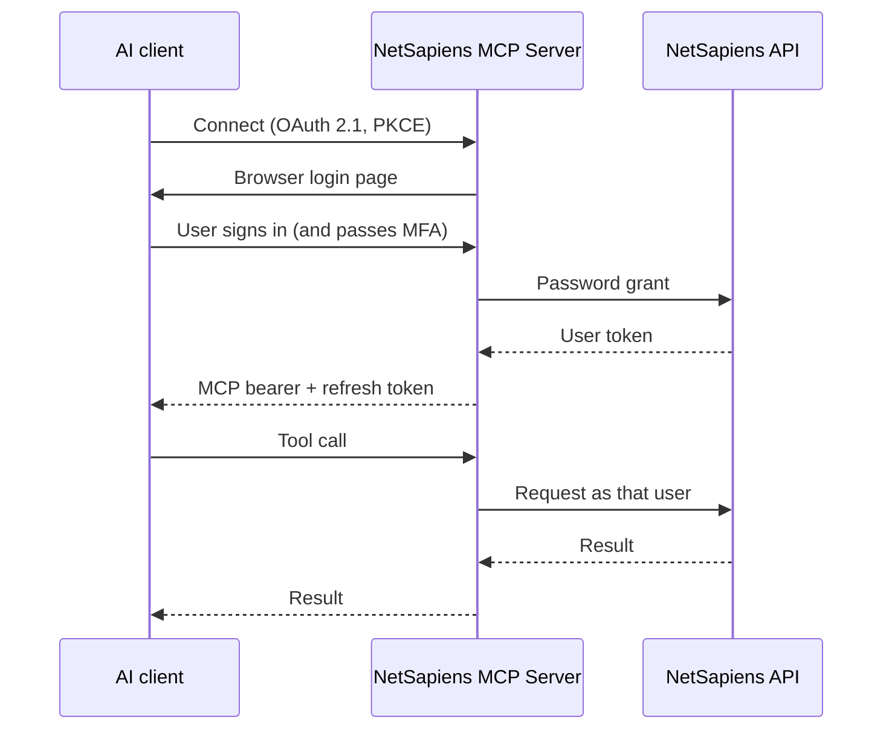

# NetSapiens MCP Server

**Run your NetSapiens phone system from Claude, ChatGPT, or any MCP client.**

[](https://opensource.org/licenses/MIT)
[](https://www.typescriptlang.org/)
[](https://docs.ns-api.com/)
[](https://modelcontextprotocol.io/)
[](https://cloud.google.com/run)

A hosted, multi-user MCP server for NetSapiens. Each person signs in with their own NetSapiens account, and their AI assistant gets a focused set of tools for calls, voicemail, messages, queues, and agents. Everything else in the v1 and v2 API is one search away.

## Ask it things

| Say this | The assistant uses |
|---|---|
| "Why did the call from 602-555-0143 go to voicemail?" | `diagnose_call` |
| "Tell me everything about Dana Reyes." | `user_profile` |
| "Which queues have people waiting right now?" | `queue_health` |
| "Summarize my new voicemails." | `voicemail_inbox_summary` |
| "Forward my calls to my cell." | `schedule_forwarding` |
| "Move me from Support to Sales." | `switch_queue` |
| "Call Marcus in accounting." | `find_and_call` |
| "What has this number been doing lately?" | `recent_activity_for_number` |

## Highlights

- **Sign in as yourself.** Login happens on a page this server hosts, with MFA support. Your NetSapiens password never reaches the model.
- **Claude and ChatGPT.** Both connect out of the box.
- **Stays connected.** 7-day sessions, silent NetSapiens token refresh, and Firestore persistence mean a deploy does not log anyone out.
- **39 task-shaped tools.** Find a user, trace a call, check a queue, read a voicemail. A basic user sees about 25 of them, and admins see the full set.
- **The whole API.** 727 operations, generated from the NetSapiens v1 and v2 specs. `search_api` finds the one you need and `call_api` runs it.
- **Safe defaults.** Token, key, and certificate endpoints are never generated. Privileged tools are hidden from lower roles. Destructive calls can ask the user to confirm in the chat.
- **Learns your habits.** Tools you keep reaching for move into your default list.
- **Operator controls.** Disable tools by glob, brand the login page, and set policy with environment variables. No code changes.

## How it works



Every tool call runs as the signed-in user, so NetSapiens permissions apply exactly as they do in the portal. More detail in [docs/oauth-flow.md](docs/oauth-flow.md).

## Quick start

### Connect to a hosted server

Give your AI client the server URL:

```
https://mcp.example.com/mcp
```

The client registers itself, sends you to the login page, and you are connected.

### Run your own

```bash
npm install
npm run build

export MCP_TRANSPORT=http
export MCP_PORT=3000
export MCP_BASE_URL=https://mcp.example.com
export NETSAPIENS_API_URL=https://edge.example.com
export NETSAPIENS_OAUTH_CLIENT_ID=<operator-client-id>
export NETSAPIENS_OAUTH_CLIENT_SECRET=<operator-client-secret>
export MCP_SESSION_SECRET=<32+ random hex>

npm start
```

Production setup for Cloud Run, with the full list of environment variables, is in [docs/hosting.md](docs/hosting.md).

### Run locally over stdio

Build as above, set `NETSAPIENS_API_URL` and `NETSAPIENS_API_TOKEN`, and add this to your MCP client config (Claude Desktop, for example):

```json
{
  "mcpServers": {
    "netsapiens": {
      "command": "node",
      "args": ["/path/to/netsapiens-mcp/build/index.js"]
    }
  }
}
```

## Documentation

| Guide | What's in it |
|---|---|
| [Hosting and configuration](docs/hosting.md) | HTTP mode, Cloud Run, environment variables, login page branding, token lifetime, health checks |
| [Tools](docs/tools.md) | The tool catalog, API discovery, per-user promotion |
| [Security model](docs/security.md) | What is never exposed, role tiers, destructive-action confirmation |
| [OAuth flow](docs/oauth-flow.md) | The login handshake step by step |
| [Development](docs/development.md) | Regenerating tools from the specs, repo layout |

## License

MIT
